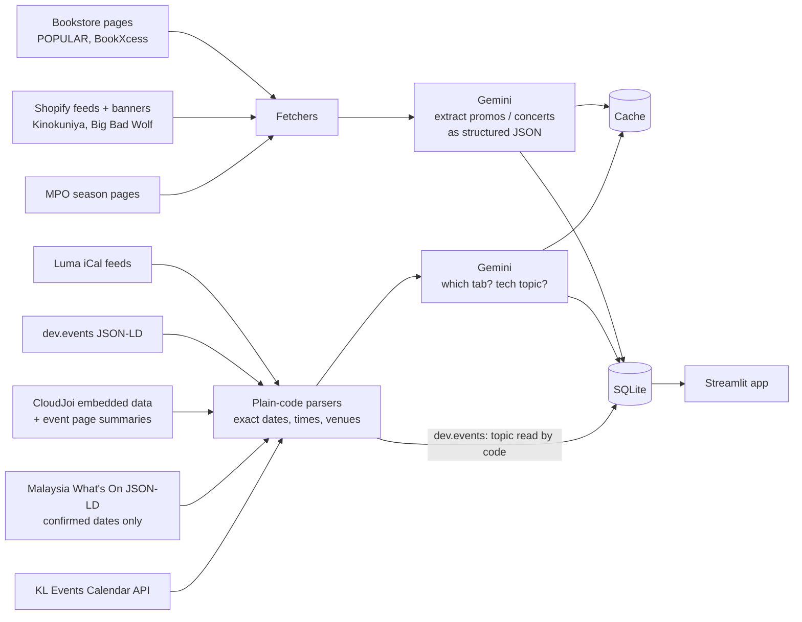

# What's On Malaysia

A personal dashboard that collects **book promotions**, **tech events**, **orchestra & classical concerts**, **hobby workshops** and **video game events** in Malaysia into one place, and refreshes them on demand.

It uses an LLM (Google Gemini) only where judgement is needed — reading messy promo pages and banner images, and deciding which tab an event belongs in — and plain code everywhere else. Its accuracy is measured against hand-labelled test sets.

**Live demo:** _coming soon_


---

## Features

- **Five tabs:** 📚 Books · 💻 Tech events · 🎻 Orchestra & classical · 🎨 Workshops · 🎮 Video games.
- **One-click refresh per tab**, so you only wait for what you need.
- **🆕 New** labels for anything that wasn't there at your last refresh, plus **⏰ Ends in X days** / **📅 Tomorrow** countdowns.
- **"This weekend" / "Next 7 days" filter** that keeps anything running at some point in that window.
- **Topic filter for tech events** (AI, Web & Mobile, Cloud & DevOps, Data, Security, Design, Startup, Other tech).
- **Reads offers shown only in images** — e.g. a "25% discount" that appears on a banner but nowhere in the text.
- **The same event from several sites appears once**, even when the sites word the title differently or disagree on the first day.
- **Private Want / Going plans** — after a password, a "My plan" dropdown appears on every row and a 📌 My plans tab lets you drag events between ⭐ Want and ✅ Going. Without the password, none of this is visible.
- **Survives bad runs** — an item missing from one refresh is kept until its end date, so a single model mistake doesn't erase it.

## How it works



| Source | Tab | Type | How it's read |
|---|---|---|---|
| POPULAR, BookXcess | Books | HTML page | Page text → Gemini extracts promos |
| Kinokuniya, Big Bad Wolf | Books | Shopify Atom feed | Feed text + each post's banner image (`og:image`) → Gemini; sales in other countries are skipped |
| DevMalaysia, Malaysian AI, Luma KL | Tech | iCal feeds | Parsed with code; Gemini only filters for tech and adds a topic |
| dev.events | Tech | JSON-LD in the page | Parsed with code, including the topic — no LLM at all |
| CloudJoi | Orchestra, Workshops, Video games | Data embedded in the page (`__NEXT_DATA__`) | Dates, venues and prices parsed with code; vague events get their page summary (read once, cached); Gemini only sorts events into tabs |
| Malaysian Philharmonic Orchestra | Orchestra | Season pages (this year and next) | Page text → Gemini extracts concerts; code handles dates and removes past ones |
| Malaysia What's On | Orchestra, Workshops, Video games | JSON-LD on each event page (cached for a week) | Parsed with code; events whose dates are only *tentative* are skipped; Gemini sorts the rest into tabs |
| KL Events Calendar | Orchestra, Workshops, Video games | Public events API (WordPress plugin) | Parsed with code, including the site's own categories; Gemini sorts events into tabs |
| Watchlist | Video games | Hand-written list | Big yearly gaming events to check by hand, with one-click Google searches |

## Accuracy

Measured with frozen snapshots of the source pages and hand-labelled answer sheets (`eval/`). Scores are for `gemini-3.6-flash` (fallback: `gemini-3.5-flash-lite`). Each model is measured separately, because different models draw borderline lines differently.

**Bookstore promos** — 29 promos, 3 stores (snapshot from 11 Oct 2026):

| | Recall | Precision | Dates | Key details | Channel |
|---|---|---|---|---|---|
| Text only (baseline) | 86% | 100% | 100% | 100% | — |
| + banner images | **100%** | **100%** | **100%** | **100%** | **97%** |

All four promos missed by the baseline were offers shown only in banner images. The one channel error is a judgement call: a voucher obtained "via Kota Buku", which the model labels "online". Re-run after adding the "skip sales abroad" rule: unchanged.

**Tech-event filter** — 13 events from the Luma KL feed, labelled *before* seeing the model's answers: **100% recall, 80% precision** (4 tech events). The one error is a borderline startup event; I chose not to tune the prompt for it (see Lessons).

**Event sorting (orchestra / workshop / video games)** — 90 CloudJoi events, labelled from each event's page before running the model:

| | Orchestra recall | Orchestra precision | Workshop recall | Workshop precision |
|---|---|---|---|---|
| Homepage data only | 1/4 = 25% | 100% | 7/7 = 100% | 100% |
| **+ event page summaries** | **3/4 = 75%** | **100%** | **6–7/7** | **100%** |

The model wasn't reasoning badly: for *The 9th* (Beethoven's 9th Symphony) it had only been given "Category: Music". Adding each event's own page summary fixed it. The remaining orchestra miss is a borderline opera-and-Broadway recital; the workshop that flips between runs has a one-line summary ("Let's Paint! (and Play?)"). Adding the video games kind moved no events into the wrong tab.

**Caveats:** these are small test sets from single snapshots. 100% means "no errors found on this set", not "never wrong". The fallback model is measurably less accurate — on a day the main model's quota ran out, it put a talk *about* a Chinese orchestra into the Orchestra tab.

## Design decisions

- **LLM only where judgement is needed.** Event feeds already contain exact dates and venues, so they're parsed with code; Gemini only returns *which* events belong where (as numbers), so it can never get a date wrong.
- **Structured output with a schema.** Gemini must return JSON matching a Pydantic model. Fields like `channel`, `topic` and the event kind are enums, so free-text values like "Via Kota Buku" are impossible.
- **Give the model enough information.** When the classifier missed concerts, the fix wasn't rewording the prompt but adding each event's page summary — read once and cached forever, and only for vague categories like "Music" or "Event".
- **Never show a guessed date.** Malaysia What's On marks some dates as *tentative* (built from last year's edition); those events are skipped. One was a Big Bad Wolf sale that hadn't been announced.
- **Cache keyed by a hash of the model name and the full prompt** (page text, images, rules and date). Unchanged pages never use quota twice, a different model never reuses another model's answers, and empty or fallback-model answers are not cached.
- **One source can feed several tabs.** CloudJoi, Malaysia What's On and KL Events Calendar are each fetched and classified once; refreshing another tab reuses the cached answer at no extra quota.
- **Retries in one place.** Busy errors (503) are retried with backoff and quota errors (429) switch to a fallback model; the Gemini library's own hidden retries are turned off, and every request times out after 2 minutes.
- **The app and the tests fail differently on purpose.** The app falls back to a weaker model to answer quickly; the tests refuse to fall back and wait patiently instead, because a score from a different model is meaningless. They stop at once if the *daily* limit is gone, since waiting won't help.
- **Everything is pinned.** A specific model (not a `-latest` nickname, which silently changes) and exact library versions in `requirements.txt`.
- **Stable identity for items the LLM describes differently each run.** Events are matched by link, or by near-identical titles with overlapping dates across sites; promos by near-identical titles within the same store. Concerts that share one season page get a unique `#tag` on their link so they aren't merged.
- **A weaker answer never erases good data.** When a refresh returns an empty field (e.g. no end date), the value already stored is kept.
- **Private by default.** Plans only appear in a browser tab where the password was typed (Streamlit keeps each visitor's session separate), the password is compared in constant time, plans live in the database which is never committed, and with no password set the feature is switched off entirely.
- **Respect each site's rules.** Every source's `robots.txt` was read before adding it, and a site that blocks AI crawlers was left out because this app sends listings to an LLM.
- **Link out, don't copy.** Each row shows only a short summary and links to the original listing, so readers go to the organiser's site for full details and tickets.
- **Polite fetching with a circuit breaker.** Pages are read at most once a second, downloads stop at the first "too many requests", and event pages and banners are cached.
- **Refresh cooldown** of 6 hours on the public app, to protect the free API quota and the websites.
- **Malaysia time everywhere.** Feeds and cloud servers use UTC; all dates are converted to UTC+8 in one place (`clock.py`).
- **Database migrations** instead of deleting data when the structure changes.
- **Check a source before adding it.** Every source was probed first for freshness, structure and permission, and many were rejected (see Lessons).
- **Automation where it's reliable, a human where it isn't.** Big yearly gaming events are announced on social media, so the games tab adds a hand-written watchlist below the automatic results.

## Lessons learned (bugs found and fixed)

- **A UTC date bug** — posts published just after midnight in Malaysia showed the previous day. Found while writing the answer sheet, not by looking at the app.
- **An unfrozen test set** — my first eval re-downloaded live pages, so a week later the scores dropped for reasons unrelated to the model. Fixed by freezing inputs and labels together.
- **A greedy matching bug in the test script** paired the wrong promos and blamed the model for the script's own mistake.
- **The answer sheet was wrong too** — the model read "25%" from a banner where my label said 15%, and several of my workshop labels broke my own written rules. Every disagreement is checked against the source, in both directions.
- **Missing information looks like bad reasoning** — the classifier "missed" Beethoven's 9th because the data it was given only said "Category: Music".
- **A regression from an unrelated prompt change** — adding topic tags (including a "Startup" topic) made the tech filter start including startup events. The regression test caught it.
- **Not overfitting a small test set** — on a newer model the same startup event slipped back in. Rather than rewrite the prompt again for one borderline case out of 13, I recorded it and left the prompt alone.
- **Silent failures** — a model reply in the wrong format used to become "zero promos" with no warning. Now it's retried, logged and shown to the user.
- **Duplicates that only appeared over time** — the model words titles slightly differently between runs, and the same event appears on several sites. None of this showed up in single-run testing.
- **"Same start date" was too strict** — two sites listed one concert from different first days (one included a preview night). Matching now uses overlapping dates.
- **A duplicate check can't remove old duplicates** — a copy saved before the fix kept matching *itself* by its own link, so it needed a one-off clean-up.
- **A weaker answer overwrote a correct one** — the fallback model missed an end date the main model had read, and saving erased it.
- **A test that tested the wrong model** — on a busy day every answer came from the fallback model. Tests now pin the main model.
- **Using an LLM where it wasn't needed** — dev.events only lists tech events, but the LLM tech filter dropped 3 of its 4 conferences. Its topics are now read with simple code.
- **Hidden retries multiplied** — the Gemini library retried silently inside our own retries, so the app looked frozen for minutes.
- **An unpinned library update broke the model name** — a new version switched to a different API version where `gemini-flash-latest` doesn't exist. Versions are now pinned.
- **A file in the wrong encoding** — `requirements.txt` was created with PowerShell's `>`, which writes UTF-16; the hosting service expects UTF-8.
- **A robots.txt check that gave the wrong answer** — Python's `robotparser` fetches the file with its own identity; when a site refused that, it reported "forbidden" without reading the rules. Reading the file directly showed the site welcomed us.
- **Structured data can be wrong** — one ticketing site's machine-readable dates contradicted its own page (ending before it started, two months off), so it was rejected.
- **A prompt rule isn't a guarantee** — a sale in the UAE got past "Malaysia only"; the rule now names the currencies (AED, THB, PHP…) that give a foreign sale away.
- **Rejected sources:** a bookshop feed abandoned since 2023, a ticketing site's blog feed, a gaming news feed with one Malaysian event in two months of posts, allevents.in (its robots.txt blocks AI crawlers such as ClaudeBot from the whole site; since this app sends listings to an LLM, I respected that), Eventbrite (no public event-search API, and its terms forbid scraping), eventsize.com (only stale listings), the KLCC Convention Centre page (events load in the browser; its big events already come via other sources), and two sites that block automated visitors outright.

## Limitations

- On the free hosting tier, the database and cache reset when the app restarts; one refresh per tab rebuilds them.
- **Plans only work when the app runs locally.** The live site has no plans password set, so the feature is switched off there — saved plans would be lost on every restart.
- The free Gemini tier is sometimes overloaded or out of daily quota; refreshes then fall back to a weaker model, or fail until it recovers.
- MPH has no machine-readable promo page; its offers are mostly in images and on Instagram, so it isn't covered.
- CloudJoi is read from its homepage, which lists about 100 events, so some events further down its listings are missed.
- Video game events are scarce in structured sources; most come from Malaysia What's On, plus the hand-written watchlist (`watchlist.json`).

## Tech stack

Python · Streamlit · streamlit-sortables · Google Gemini (`google-genai`) · Pydantic · SQLite · pandas · BeautifulSoup · feedparser · icalendar

## Run it locally (Windows)

```powershell
git clone https://github.com/mIkhwan-hubgit/bookstore-promos.git
cd bookstore-promos
python -m venv .venv
.venv\Scripts\activate
python -m pip install -r requirements.txt
```

Create a `.env` file (see `.env.example`):

```
GEMINI_API_KEY=your-key-here
GEMINI_MODEL=gemini-3.6-flash
GEMINI_FALLBACK_MODEL=gemini-3.5-flash-lite
PLANS_PASSWORD=choose-a-password
```

`PLANS_PASSWORD` is optional: leave it out and the plans feature is switched off.

Then:

```powershell
streamlit run app.py
```

Run the accuracy tests:

```powershell
python eval_run.py          # bookstore promos
python eval_events_run.py   # tech-event filter
python eval_kinds_run.py    # orchestra / workshop / video games sorting
```

## Project structure

```
app.py                  Streamlit app: tabs, filters, refresh, watchlist, private plans
sources.py              List of sources (name, tabs, type, URL, options)
fetcher.py              HTML, Atom feed, banner, iCal, JSON-LD, CloudJoi, Malaysia What's On and KL Events Calendar fetching
llm.py                  Gemini calls: promo and concert extraction, tech filter, event sorting, cache, retries
schema.py               Pydantic models and enums
events.py               Turns calendar events and concerts into table rows
db.py                   SQLite storage, duplicate matching, upserts, migrations, plans
clock.py                Malaysia-time helpers
watchlist.json          Hand-written list of video game events to check
eval_*.py               Snapshot, image and scoring scripts for the accuracy tests
eval/                   Frozen page snapshots and hand-labelled answer sheets
```

## Future work

- Plans on the live site, stored in a free external database so they survive restarts
- Larger, rolling test sets (a new labelled snapshot every few weeks)
- Workshops from the Luma KL feed (currently discarded by the tech filter)
- Banner reading for MPH and the BookXcess homepage
