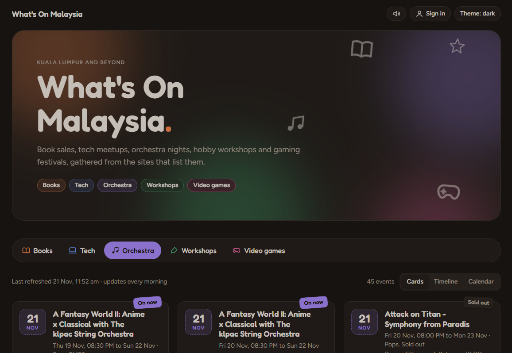
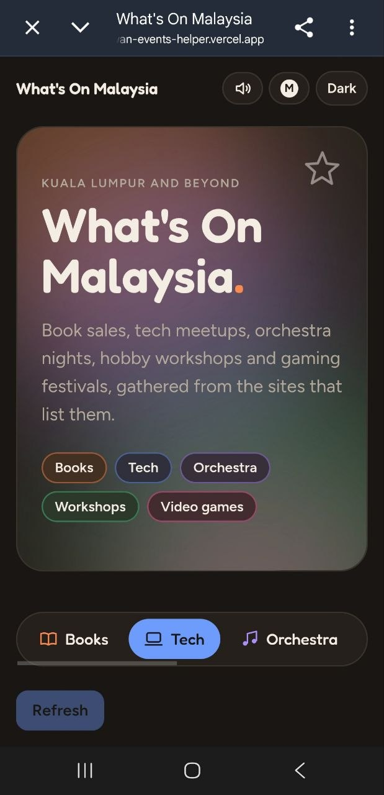
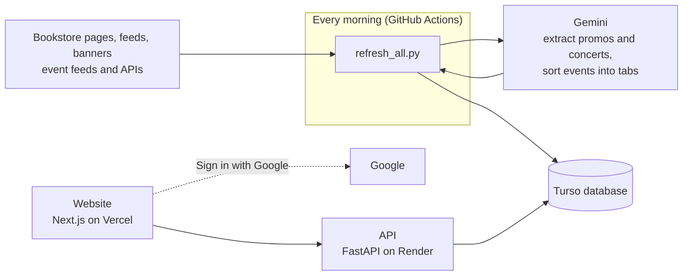

# What's On Malaysia

A website that collects **book promotions**, **tech events**, **orchestra & classical concerts**, **hobby workshops** and **video game events** in Malaysia into one place, refreshed automatically every morning.

It uses an LLM (Google Gemini) only where judgement is needed — reading messy promo pages and banner images, and deciding which tab an event belongs in — and plain code everywhere else. Its accuracy is measured against hand-labelled test sets.

**Live site:** https://ikhwan-events-helper.vercel.app




---

## Features

- **Five tabs**, each with its own colour: Books · Tech · Orchestra · Workshops · Video games.
- **Three ways to browse:** cards, a timeline, or a month calendar (tap a busy day to see everything on it). The site remembers your last tab and layout, so reloading the page brings you back to them.
- **Fresh every morning** — every tab is refreshed at 7 a.m. Malaysia time, so visitors never wait for scraping.
- **Stickers** for what's new, on now, starting today or tomorrow, ending soon, and sold out, plus your own ★ Want / ✓ Going marks, shown in all three views (cards, timeline and calendar).
- **Reads offers shown only in images** — e.g. a "25% discount" that appears on a banner but nowhere in the text.
- **The same event from several sites appears once**, even when the sites word the title differently or disagree on the first day.
- **Personal Want / Going plans** — sign in with Google, then mark events or drag them between two columns. Confetti when you decide to go; sound effects are optional and off by default. Plans are private and follow you across devices.
- **Explore on Eventsize** — every tab ends with keyword links (e.g. *pottery*, *hackathon*, *cosplay*) that search Eventsize's Malaysian pages, since that site can't be read automatically.
- **Light and dark mode**, animations that respect "reduce motion", and a layout built for phones as much as computers.
- **Survives bad runs** — an item missing from one refresh is kept until its end date, so a single model mistake doesn't erase it.

## How it works



1. Every morning at 7:00, a free outside timer (cron-job.org) starts a GitHub Actions job through GitHub's API, and the job runs `refresh_all.py`. It reads each source, asks Gemini only the questions that need judgement, and saves the results to the database.
2. The website is a Next.js app on Vercel. It asks the Python API on Render for the events, and for each signed-in person's plans.
3. Sign-in uses Google: Google confirms who someone is, and the API keeps only their name, email and plans.

| Source | Tab | Type | How it's read |
|---|---|---|---|
| POPULAR, BookXcess | Books | HTML page | Page text → Gemini extracts promos |
| Kinokuniya, Big Bad Wolf | Books | Shopify Atom feed | Feed text + each post's banner image (`og:image`) → Gemini; sales in other countries are skipped |
| DevMalaysia, Malaysian AI, Luma KL | Tech | iCal feeds | Parsed with code; Gemini only filters for tech and adds a topic |
| dev.events | Tech | JSON-LD in the page | Parsed with code, including the topic — no LLM at all |
| CloudJoi | Orchestra, Workshops, Video games | Data embedded in the page (`__NEXT_DATA__`) | Dates, venues and prices parsed with code; vague events get their page summary (read once, cached); Gemini only sorts events into tabs |
| Malaysian Philharmonic Orchestra | Orchestra | Season pages (this year and next) | Page text → Gemini extracts concerts; code handles dates and removes past ones |
| Malaysia What's On | Orchestra, Workshops, Video games | JSON-LD on each event page (cached for a week) | Parsed with code; events whose dates are only *tentative* are skipped; Gemini sorts the rest into tabs |
| KL Events Calendar | Orchestra, Workshops, Video games | Public events API (WordPress plugin) | Parsed with code, including the site's own categories; Gemini sorts events into tabs |
| Watchlist | Video games | Hand-written list | Big yearly gaming events to check by hand, with one-click Google searches |
| Eventsize keywords | All tabs | Links only (`web/lib/eventsize.ts`) | Keyword links that open a search of eventsize.com; nothing is read from the site |

## Accuracy

Measured with frozen snapshots of the source pages and hand-labelled answer sheets (`eval/`). Scores are for `gemini-3.6-flash` (fallback: `gemini-3.5-flash-lite`). Each model is measured separately, because different models draw borderline lines differently.

**Bookstore promos** — 29 promos, 3 stores (snapshot from 11 Oct 2026):

| | Recall | Precision | Dates | Key details | Channel |
|---|---|---|---|---|---|
| Text only (baseline) | 86% | 100% | 100% | 100% | — |
| + banner images | **100%** | **100%** | **100%** | **100%** | **97%** |

All four promos missed by the baseline were offers shown only in banner images. The one channel error is a judgement call: a voucher obtained "via Kota Buku", which the model labels "online". Re-run after adding the "skip sales abroad" rule: unchanged.

**Tech-event filter** — 13 events from the Luma KL feed, labelled *before* seeing the model's answers: **100% recall, 80% precision** (4 tech events). The one error is a borderline startup event; I chose not to tune the prompt for it (see Lessons).

**Event sorting (orchestra / workshop / video games)** — 90 CloudJoi events, labelled from each event's page before running the model:

| | Orchestra recall | Orchestra precision | Workshop recall | Workshop precision |
|---|---|---|---|---|
| Homepage data only | 1/4 = 25% | 100% | 7/7 = 100% | 100% |
| **+ event page summaries** | **3/4 = 75%** | **100%** | **6–7/7** | **100%** |

The model wasn't reasoning badly: for *The 9th* (Beethoven's 9th Symphony) it had only been given "Category: Music". Adding each event's own page summary fixed it. The remaining orchestra miss is a borderline opera-and-Broadway recital; the workshop that flips between runs has a one-line summary ("Let's Paint! (and Play?)"). Adding the video games kind moved no events into the wrong tab.

**Caveats:** these are small test sets from single snapshots. 100% means "no errors found on this set", not "never wrong". The fallback model is measurably less accurate — on a day the main model's quota ran out, it put a talk *about* a Chinese orchestra into the Orchestra tab.

## Design decisions

**Collecting the data**

- **LLM only where judgement is needed.** Event feeds already contain exact dates and venues, so they're parsed with code; Gemini only returns *which* events belong where (as numbers), so it can never get a date wrong.
- **Structured output with a schema.** Gemini must return JSON matching a Pydantic model. Fields like `channel`, `topic` and the event kind are enums, so free-text values like "Via Kota Buku" are impossible.
- **Give the model enough information.** When the classifier missed concerts, the fix wasn't rewording the prompt but adding each event's page summary — read once and cached, and only for vague categories like "Music" or "Event".
- **Code checks the model's work where it can.** Gemini is told to skip sales abroad, and a simple rule in code then drops any promo that still mentions a foreign currency or city — the code is predictable where the model isn't.
- **Never show a guessed date.** Malaysia What's On marks some dates as *tentative* (built from last year's edition); those events are skipped.
- **Cache keyed by a hash of the model name and the full prompt** (page text, images, rules and date). Unchanged pages never use quota twice, a different model never reuses another model's answers, and empty or fallback-model answers are not cached. The daily job keeps this cache between runs.
- **One source can feed several tabs.** CloudJoi, Malaysia What's On and KL Events Calendar are each fetched and classified once per run; the other tabs reuse the cached answer.
- **Retries in one place.** Busy errors (503) are retried with backoff and quota errors (429) switch to a fallback model; the Gemini library's own hidden retries are turned off, and every request times out after 2 minutes.
- **The app and the tests fail differently on purpose.** The app falls back to a weaker model to keep going; the tests refuse to fall back and wait instead, because a score from a different model is meaningless.
- **Everything is pinned.** A specific model (not a `-latest` nickname, which silently changes) and exact library versions.
- **Stable identity for items the LLM describes differently each run.** Events are matched by link, or by near-identical titles with overlapping dates across sites; promos by near-identical titles within the same store.
- **A weaker answer never erases good data.** When a refresh returns an empty field (e.g. no end date), the value already stored is kept.
- **Respect each site's rules.** Every source's `robots.txt` was read before adding it, and a site that blocks AI crawlers was left out because this project sends listings to an LLM. Fetching is polite: at most one page a second, stopping at the first "too many requests".
- **Link out, don't copy.** Each card shows only a short summary and links to the original listing for full details and tickets.
- **Malaysia time everywhere.** Feeds and cloud servers use UTC; all dates are converted to UTC+8 in one place (`clock.py`).

**Running it online for free**

- **Scheduled refresh instead of a refresh button.** A GitHub Actions job refreshes every tab each morning and writes straight to the database, so visitors never wait and never spend the Gemini quota. Only the site owner gets a manual Refresh button, as a backup.
- **A database that survives restarts.** Free web hosting wipes its disk on every restart, so the data lives in Turso (hosted SQLite), reached over HTTP. On my own computer the same code uses a local SQLite file.
- **Split front end and API.** The website (Next.js, on Vercel) only displays data; the Python API (FastAPI, on Render) owns the database and sign-in. The API only accepts requests from the website's own address.
- **Sign in with Google instead of passwords.** The site never sees or stores a password. The API checks Google's signed message (that it's genuine, meant for this site and not expired), then issues its own short token signed with a server-side secret. Plans are stored per person; anyone can delete their account and plans from the site.
- **Instant feedback.** Plan changes show immediately and are undone if the server says no, so dragging feels instant even on a sleepy free server.

## Security

- **No passwords stored.** Sign-in is done by Google; the API checks Google's signed message, then issues its own token signed with a server-side secret (30-day expiry). Anyone can delete their account and plans.
- **Locked-down API.** It only accepts requests from the website's own address, limits the size of everything it stores, caps plans per person, hides its auto-generated docs in production, and only the owner can trigger a refresh.
- **Security headers** on the website: a Content Security Policy, no framing by other sites, no MIME sniffing, a strict referrer policy and no camera/microphone/location access.
- **Untrusted input stays untrusted.** Scraped pages and the LLM's answers must fit a strict schema, only `http(s)` links are kept, and React escapes all text.
- **Supply chain.** Exact versions and lockfiles; Dependabot updates with a 7-day cooldown; GitHub Actions pinned to commit SHAs with a read-only token; secret scanning with push protection; CodeQL code scanning. The server installs only what it runs: keeping the old Streamlit app's libraries out removed 42 known vulnerabilities (in Pillow) from production.
- **Known trade-off:** the sign-in token is kept in browser storage (simpler with the website and API on different domains); the Content Security Policy limits what an injected script could do with it.

To report a problem, see [SECURITY.md](SECURITY.md).

## Lessons learned (bugs found and fixed)

- **A UTC date bug** — posts published just after midnight in Malaysia showed the previous day. Found while writing the answer sheet, not by looking at the app.
- **An unfrozen test set** — my first eval re-downloaded live pages, so a week later the scores dropped for reasons unrelated to the model. Fixed by freezing inputs and labels together.
- **A greedy matching bug in the test script** paired the wrong promos and blamed the model for the script's own mistake.
- **The answer sheet was wrong too** — the model read "25%" from a banner where my label said 15%, and several of my workshop labels broke my own written rules. Every disagreement is checked against the source, in both directions.
- **Missing information looks like bad reasoning** — the classifier "missed" Beethoven's 9th because the data it was given only said "Category: Music".
- **A regression from an unrelated prompt change** — adding topic tags made the tech filter start including startup events. The regression test caught it.
- **Not overfitting a small test set** — on a newer model the same startup event slipped back in. Rather than rewrite the prompt again for one borderline case out of 13, I recorded it and left the prompt alone.
- **Silent failures** — a model reply in the wrong format used to become "zero promos" with no warning. Now it's retried, logged and reported.
- **"Same start date" was too strict** — two sites listed one concert from different first days. Matching now uses overlapping dates.
- **A weaker answer overwrote a correct one** — the fallback model missed an end date the main model had read, and saving erased it.
- **A test that tested the wrong model** — on a busy day every answer came from the fallback model. Tests now pin the main model.
- **Using an LLM where it wasn't needed** — dev.events only lists tech events, but the LLM tech filter dropped 3 of its 4 conferences. Its topics are now read with simple code.
- **Hidden retries multiplied** — the Gemini library retried silently inside our own retries, so runs looked frozen for minutes.
- **An unpinned library update broke the model name** — a new version switched API versions. Versions are now pinned.
- **A file in the wrong encoding** — `requirements.txt` was created with PowerShell's `>`, which writes UTF-16; hosting services expect UTF-8.
- **A robots.txt check that gave the wrong answer** — Python's `robotparser` fetches the file with its own identity; when a site refused that, it reported "forbidden" without reading the rules.
- **A prompt rule isn't a guarantee** — a sale in the UAE got past "Malaysia only"; naming the currencies (AED, THB, PHP…) in the prompt helped, but a UAE contest still slipped through later. Now plain code double-checks every promo after Gemini and drops anything mentioning a foreign currency, city or handle (checked against all 46 saved promos: it caught the UAE one and nothing else).
- **A pasted secret with an invisible line break** — the database token saved in GitHub's secrets ended with a newline, which made every request fail. The code now trims settings before using them.
- **Free quotas reset on someone else's clock** — Gemini's daily limit resets at midnight Pacific time (4 p.m. in Malaysia), so late-night testing used up the quota for the next morning's run. The daily job now has its own key.
- **Free schedules aren't punctual** — GitHub's own scheduler started the "7 a.m." job almost 5 hours late, and on another day not at all by 8:30. The 7 a.m. run is now started by an outside timer through GitHub's API (on time to the minute), using a key that can only start Actions on this one repo. GitHub's schedule stays as a backup at 9:37 a.m. and skips any tab already refreshed that day, so a late backup can't wipe the morning's "NEW!" stickers.
- **One long line made the whole page zoom out on phones** — in a CSS grid, an item won't shrink below its longest unbreakable line by default. The timeline grew three times wider than the screen until the grid was told it may shrink (`minmax(0, 1fr)`).
- **Not every automatic update is safe** — Dependabot's website update included TypeScript 7, a major version. The site still built, but the code checker (ESLint) stopped working because its TypeScript plugin doesn't support version 7 yet. Each update is now tested before merging, and major TypeScript updates are skipped until the tools catch up.
- **Reading security alerts critically** — CodeQL flagged two things. One was real: error messages from failed sources (which can contain internal details) were sent to the page, so now the full error only goes to the server log and the page gets a short summary. The other was a false positive: signing tokens with HMAC-SHA256 and a random server secret looks like weak password hashing to the scanner, so it was dismissed with a written reason.
- **Redeploying the wrong version** — on the hosting dashboard, "Redeploy" on an older row rebuilt an older commit and quietly replaced the newest one.
- **A one-line edit broke only sign-in** — while adding a new setting, an existing one (`TOKEN_DAYS`) was overwritten. Browsing still worked, so nothing looked wrong until someone signed in and the API crashed. The browser reported it as a confusing "CORS" error, because a crashed server sends no permission headers; the server's own log showed the real cause (`NameError`). Lesson: read the server log first, and test the sign-in path before every release.
- **Rejected sources:** a bookshop feed abandoned since 2023, a ticketing site's blog feed, a gaming news feed with one Malaysian event in two months of posts, allevents.in (its robots.txt blocks AI crawlers such as ClaudeBot from the whole site; since this project sends listings to an LLM, I respected that), Eventbrite (no public event-search API, and its terms forbid scraping), eventsize.com (re-checked in November 2026: the public page still showed only February events, and every page answers automated visitors with Cloudflare's "Just a moment..." bot check; getting around a bot check isn't something this project does; each tab links to Eventsize searches instead, and I've asked the site for permission or a feed), the KLCC Convention Centre page (events load in the browser; its big events already come via other sources), and two sites that block automated visitors outright.

## Limitations

- **The free server sleeps.** After about 15 minutes without visitors, the API on Render's free plan goes to sleep, so the first visit after that can take up to a minute ("Waking up the free server...").
- **The morning run depends on two free services.** If the outside timer fails, GitHub's backup schedule fills in later that morning (it can be hours late); the job can also be run by hand.
- The free Gemini tier is sometimes overloaded or out of daily quota; a run then falls back to a weaker model, or keeps yesterday's results for the sources it couldn't read.
- MPH has no machine-readable promo page; its offers are mostly in images and on Instagram, so it isn't covered.
- CloudJoi is read from its homepage, which lists about 100 events, so some events further down its listings are missed.
- Video game events are scarce in structured sources; most come from Malaysia What's On, plus the hand-written watchlist (`watchlist.json`).

## Tech stack

**Website:** Next.js 16 · React 19 · TypeScript · Tailwind CSS 4 · Motion · dnd-kit · canvas-confetti · Google Identity Services — hosted on Vercel

**API and data:** Python 3.13 · FastAPI · Google Gemini (`google-genai`) · Pydantic · google-auth · Turso (`turso_serverless`) / SQLite · BeautifulSoup · feedparser · icalendar — hosted on Render

**Automation:** GitHub Actions (daily refresh)

The first version was a Streamlit app (`app.py`); it still runs locally.

## Run it locally (Windows)

**1. The Python side**

```powershell
git clone https://github.com/mIkhwan-hubgit/events-promos-helper.git
cd events-promos-helper
python -m venv .venv
.venv\Scripts\activate
python -m pip install -r requirements.txt
```

Create a `.env` file (see `.env.example`):

```
GEMINI_API_KEY=your-key-here
GEMINI_MODEL=gemini-3.6-flash
GEMINI_FALLBACK_MODEL=gemini-3.5-flash-lite
GOOGLE_CLIENT_ID=your-client-id.apps.googleusercontent.com
SESSION_SECRET=a-long-random-string
OWNER_EMAIL=you@gmail.com
```

Without `TURSO_DATABASE_URL`, everything uses a local `promos.db` file. The three sign-in settings are optional: leave them out and accounts are switched off. Add `SHOW_API_DOCS=1` to see the API's automatic documentation at http://localhost:8000/docs (it's hidden on the live server).

```powershell
python refresh_all.py                            # fill the database (all tabs)
python -m uvicorn api:app --reload --port 8000   # start the API
```

**2. The website** (needs Node.js), in a second terminal:

```powershell
cd web
npm install
```

Create `web/.env.local`:

```
NEXT_PUBLIC_API_URL=http://localhost:8000
NEXT_PUBLIC_GOOGLE_CLIENT_ID=your-client-id.apps.googleusercontent.com
```

```powershell
npm run dev
```

Then open http://localhost:3000.

**Accuracy tests:**

```powershell
python eval_run.py          # bookstore promos
python eval_events_run.py   # tech-event filter
python eval_kinds_run.py    # orchestra / workshop / video games sorting
```

**The original Streamlit version** needs a few extra libraries, kept out of the live server on purpose:

```powershell
python -m pip install -r requirements-streamlit.txt
streamlit run app.py
```

## Going live (what each service needs)

| Service | Settings |
|---|---|
| **Turso** (database) | Create a database; `copy_to_turso.py` copies a local `promos.db` into it |
| **GitHub Actions** (daily refresh) | Secrets: `GEMINI_API_KEY`, `TURSO_DATABASE_URL`, `TURSO_AUTH_TOKEN` |
| **cron-job.org** (7 a.m. timer) | A daily `POST` to GitHub's "create a workflow dispatch event" API with `{"ref":"main"}`, using a fine-grained token limited to this repo with only *Actions: read and write* |
| **Render** (API) | Build `pip install -r requirements.txt`, start `uvicorn api:app --host 0.0.0.0 --port $PORT`; variables: the Gemini and Turso settings, `GOOGLE_CLIENT_ID`, `SESSION_SECRET`, `OWNER_EMAIL`, `ALLOWED_ORIGINS` (the website's address) |
| **Vercel** (website) | Root directory `web`; variables: `NEXT_PUBLIC_API_URL` (the API's address), `NEXT_PUBLIC_GOOGLE_CLIENT_ID` |
| **Google Cloud** (sign-in) | A "Web application" OAuth client whose authorized JavaScript origins include the website's address |

## Project structure

```
refresh_all.py          Refreshes every tab (run daily by GitHub Actions)
pipeline.py             Collects one tab: runs each source, saves the results
api.py                  FastAPI: events, sign-in with Google, plans, owner-only refresh
sources.py              List of sources (name, tabs, type, URL, options)
fetcher.py              HTML, feed, banner, iCal, JSON-LD and site-specific fetching
llm.py                  Gemini calls: extraction, filtering, sorting, cache, retries
schema.py               Pydantic models and enums
events.py               Turns calendar events and concerts into rows
db.py                   Storage (Turso online, SQLite locally), duplicate matching, accounts and plans
clock.py                Malaysia-time helpers
copy_to_turso.py        One-off copy of a local database into Turso
watchlist.json          Hand-written list of video game events to check
app.py                  The original Streamlit version
requirements.txt        Libraries for the live server and the daily job
requirements-streamlit.txt  Extra libraries for the Streamlit version (local only)
eval_*.py, eval/        Accuracy tests: frozen snapshots and hand-labelled answer sheets
SECURITY.md             How to report a security problem
.github/workflows/      The daily refresh schedule
.github/dependabot.yml  Weekly dependency updates (with a 7-day cooldown)
web/                    The website (Next.js)
  app/                  Pages: the main page and /privacy
  components/           Tabs, cards, timeline, calendar, details window, plans board, sign-in
  lib/                  Talking to the API, dates, sign-in, sounds and confetti, Eventsize keyword links
```

## Future work

- Larger, rolling test sets (a new labelled snapshot every few weeks)
- Workshops from the Luma KL feed (currently discarded by the tech filter)
- Banner reading for MPH and the BookXcess homepage
- Reminders before a "Going" event starts

