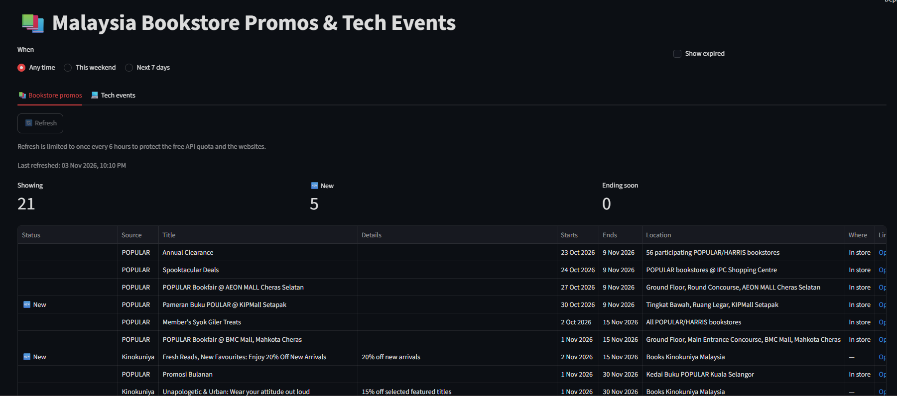
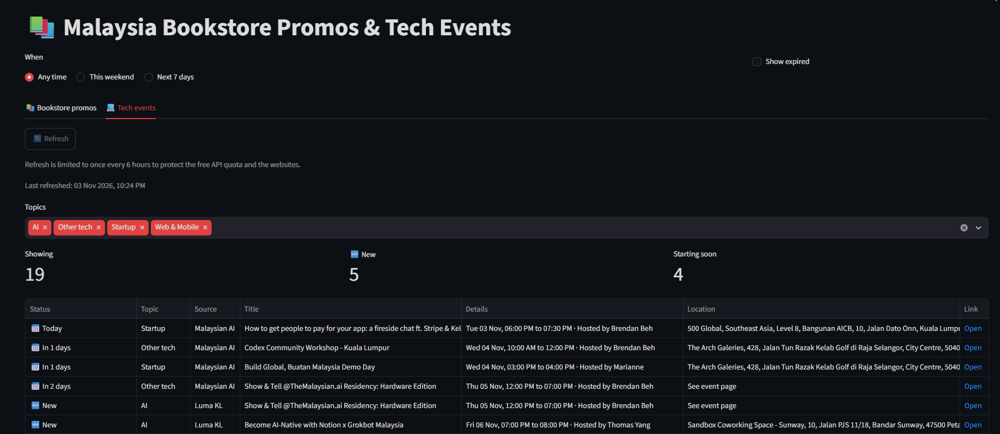
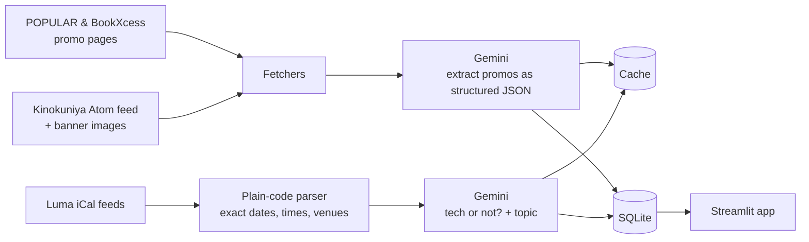

# Malaysia Bookstore Promos & Tech Events Tracker

A personal dashboard that collects **bookstore promotions** (POPULAR, Kinokuniya, BookXcess) and **tech events in Kuala Lumpur** (from Luma community calendars) into one place, and refreshes them on demand.

It uses an LLM (Google Gemini) only where judgement is needed — reading messy promo pages and banner images, and deciding which events are tech — and plain code everywhere else. Its accuracy is measured against hand-labelled test sets.

**Live demo:** _coming soon_




---

## Features

- **One-click refresh per tab** — bookstore promos and tech events refresh separately, so you only wait for what you need.
- **🆕 New** labels for anything that wasn't there at your last refresh, plus **⏰ Ends in X days** / **📅 In X days** countdowns.
- **"This weekend" / "Next 7 days" filter** that keeps anything running at some point in that window.
- **Topic filter for events** (AI, Web & Mobile, Cloud & DevOps, Data, Security, Design, Startup, Other tech).
- **Reads offers shown only in images** — e.g. a "25% discount" that appears on a banner but nowhere in the text.
- **Survives bad runs** — a promo missing from one refresh is kept until its end date, so a single model mistake doesn't erase it.

## How it works



| Source | Type | How it's read |
|---|---|---|
| POPULAR | HTML page | Page text → Gemini extracts promos |
| BookXcess | HTML page | Page text → Gemini extracts promos |
| Kinokuniya | Shopify Atom feed | Feed text + each post's banner image (`og:image`) → Gemini |
| DevMalaysia, Malaysian AI, Luma KL | iCal feeds | Parsed with code; Gemini only filters for tech and adds a topic |

## Accuracy

Measured with frozen snapshots of the source pages and hand-labelled answer sheets (`eval/`).

**Bookstore promos** — 29 promos, 3 stores (snapshot from 11 Oct 2026):

| | Recall | Precision | Dates | Key details | Channel |
|---|---|---|---|---|---|
| Text only (baseline) | 86% | 100% | 100% | 100% | — |
| + banner images | **100%** | **100%** | **100%** | **100%** | **100%** |

All four promos missed by the baseline were offers shown only in banner images.

**Tech-event filter** — 13 events from the Luma KL feed, labelled *before* seeing the model's answers: **100% precision, 100% recall** (4 tech events).

**Caveats:** these are small test sets from single snapshots. 100% means "no errors found on this set", not "never wrong". The fallback model (used when the main model is busy) is measurably less accurate — it missed 1 of 3 BookXcess promos in one run.

## Design decisions

- **LLM only where judgement is needed.** Event feeds already contain exact dates and venues, so they're parsed with code; Gemini only returns *which* events are tech (as numbers), so it can never get a date wrong.
- **Structured output with a schema.** Gemini must return JSON matching a Pydantic model. Fields like `channel` and `topic` are enums, so free-text values like "Via Kota Buku" are impossible.
- **Cache keyed by a hash of the full prompt** (page text, images, rules and date). Unchanged pages never use quota twice, and the cache invalidates itself when anything changes. Empty answers and fallback-model answers are not cached.
- **Retries, fallback model and timeouts.** Busy errors (503) are retried with backoff; daily-quota errors (429) switch straight to a fallback model; requests time out after 3 minutes.
- **Polite fetching with a circuit breaker.** Banner downloads pause between requests, stop at the first "too many requests", and are cached permanently so each banner is fetched once.
- **Refresh cooldown** of 6 hours on the public app, to protect the free API quota and the stores' websites.
- **Malaysia time everywhere.** Feeds and cloud servers use UTC; all dates are converted to UTC+8 in one place (`clock.py`).
- **Database migrations** instead of deleting data when the structure changes.

## Lessons learned (bugs found and fixed)

- **A UTC date bug** — posts published just after midnight in Malaysia showed the previous day. Found while writing the answer sheet, not by looking at the app.
- **An unfrozen test set** — my first eval re-downloaded live pages, so a week later the scores dropped for reasons unrelated to the model. Fixed by freezing inputs and labels together and restoring the original inputs from Git.
- **A greedy matching bug in the test script** paired the wrong promos and blamed the model for the script's own mistake. Replaced with best-pairs-first matching.
- **The answer sheet was wrong too** — the model read "25%" from a banner where my hand-written label said 15%. Every disagreement is checked against the source, in both directions.
- **A regression from an unrelated prompt change** — adding topic tags (including a "Startup" topic) made the tech filter start including startup events. The regression test caught it; a one-line prompt fix restored the original behaviour.
- **Silent failures** — a model reply in the wrong format used to become "zero promos" with no warning. Now it's retried, logged with the source and model name, and shown to the user.

## Limitations

- On the free hosting tier, the database and cache reset when the app restarts.
- MPH has no machine-readable promo page; its offers are mostly in images and on Instagram, so it isn't covered yet.
- Event coverage depends on what communities publish on Luma.

## Tech stack

Python · Streamlit · Google Gemini (`google-genai`) · Pydantic · SQLite · pandas · BeautifulSoup · feedparser · icalendar

## Run it locally (Windows)

```powershell
git clone https://github.com/mIkhwan-hubgit/bookstore-promos.git
cd bookstore-promos
python -m venv .venv
.venv\Scripts\activate
python -m pip install -r requirements.txt
```

Create a `.env` file (see `.env.example`):

```
GEMINI_API_KEY=your-key-here
GEMINI_MODEL=gemini-flash-latest
GEMINI_FALLBACK_MODEL=gemini-flash-lite-latest
```

Then:

```powershell
streamlit run app.py
```

Run the accuracy tests:

```powershell
python eval_run.py          # bookstore promos
python eval_events_run.py   # tech-event filter
```

## Project structure

```
app.py                  Streamlit app: tabs, filters, refresh
sources.py              List of sources (name, category, type, URL, options)
fetcher.py              HTML, Atom feed, banner image and iCal fetching
llm.py                  Gemini calls: promo extraction, tech filter, cache, retries
schema.py               Pydantic models and enums (Promo, Channel, Topic)
events.py               Turns calendar events into table rows
db.py                   SQLite storage, upserts, migrations
clock.py                Malaysia-time helpers
eval_*.py               Snapshot, image and scoring scripts for the accuracy tests
eval/                   Frozen page snapshots and hand-labelled answer sheets
```

## Future work

- Banner reading for MPH and BookXcess homepages
- Larger, rolling test sets (a new labelled snapshot every few weeks)
- More non-AI event sources (e.g. GDG Kuala Lumpur's DevFest)
